# LYNX-SHARE-FOFO — `SPT-REVIEW.1.md` Implementation & Verification Walkthrough

All phases from [`../SPT-REVIEW.1.md`](../SPT-REVIEW.1.md) have been implemented and verified headlessly on `infinity` (`192.168.1.99`, WSL2 + Windows 10 x64).

---

## Phase 0 — Orient & Baseline

### What Changed
- Created [`../AGENTS.md`](../AGENTS.md) with ground rules (sacred audio thread, headless verification, compare-like-with-like, branch/PR workflow, AGPL-3.0-or-later preservation, out-of-scope driver rules), build commands, headless verification commands, and source layout.
- Created [`FORK_MAP.md`](FORK_MAP.md) mapping the architecture across `src/core/`, `src/flp/`, `src/engine/`, `src/ui/`, `src/platform/`, `tests/`, and `tools/`, plus the lock-free boundary between `AudioEngine::audioDeviceIOCallbackWithContext` and the UI thread (`SnapshotExchange`, `TransportState`, `MeterState`, `AudioCapture`).

### Verification
- Built and ran the full JUCE-free test suite (`./build-local/lynx_tests` on `infinity`): **1,955,585 checks across 1,849 tests, 0 failures**.
- Built `build-win/LYNX.exe` (`42,838,528` bytes) and `build-win/LYNX-bridge32.exe` (`7,526,912` bytes) with Zig 0.14.1 + JUCE 8.0.4 on `infinity`, verified `--selftest` (`result=OK`), `--rectest` (`result=OK`), and baseline `--export` WAV render.

---

## Phase 1 — Fork Housekeeping

### What Changed
- **Git Remotes**: Configured `upstream` (`https://github.com/Ka1-S/LYNX-SHARE.git`) with `remote.upstream.pushurl = no_push` so accidental pushes to `upstream` are blocked, keeping `origin` pointed at `git@github.com:Sweet-Papa-Technologies/LYNX-SHARE-FOFO.git`.
- **Disabled Upstream Telemetry & Retargeted Repo URLs**:
  - [`../src/core/CrashReport.h`](../src/core/CrashReport.h): Disabled upstream Cloudflare telemetry endpoint (`defaultEndpoint = ""`) and retargeted `newIssueUrl()` to `https://github.com/Sweet-Papa-Technologies/LYNX-SHARE-FOFO/issues/new`.
  - [`../src/core/UpdateCheck.h`](../src/core/UpdateCheck.h): Disabled automatic upstream release polling (`defaultAutoCheck = false`) and retargeted `releasesApiUrl` / `releasesPageUrl` to `Sweet-Papa-Technologies/LYNX-SHARE-FOFO`.
  - [`../src/Main.cpp`](../src/Main.cpp) & [`../src/ui/MainComponent.cpp`](../src/ui/MainComponent.cpp): Retargeted Help menu and About dialog repository links to `Sweet-Papa-Technologies/LYNX-SHARE-FOFO`.
  - [`../tests/CrashReport159Tests.inc`](../tests/CrashReport159Tests.inc): Updated unit tests to assert the disabled telemetry endpoint and `Sweet-Papa-Technologies/LYNX-SHARE-FOFO` URLs.

### Verification
- `LYNX_TEST=crashreport ./build-local/lynx_tests` -> **68 checks, 0 failures**.
- `LYNX_TEST=update166b ./build-local/lynx_tests` -> **96 checks, 0 failures**.

---

## Phase 2.1 — Audio Recorder Easy to Find (Edison-Style)

### What Changed
- Added `EffectKind::edison` (`"Edison"`, id `"edison"`, category `"Delay / Reverb"`) to [`../src/core/Song.h`](../src/core/Song.h), [`../src/core/Effects.cpp`](../src/core/Effects.cpp), [`../src/core/EffectPresets.cpp`](../src/core/EffectPresets.cpp), and [`../src/core/FlEffects.cpp`](../src/core/FlEffects.cpp).
- Added pass-through `EdisonEffect` DSP processor in [`../src/core/Effects.cpp`](../src/core/Effects.cpp) (zero allocations, zero locks on the audio thread).
- Exposed `"Edison"` in:
  - Mixer effect slot menu (`src/ui/QuickPick.cpp`)
  - Quick-Add palette (`Ctrl+F` / `Cmd+F`, `src/ui/QuickAddPalette.cpp`) with keywords `"edison audio editor recorder sample wave record take"`
  - Plugin Picker (`F8`, `src/ui/PluginPicker.cpp`)
  - Clicking an `"Edison"` effect slot in the Mixer or picking `"Edison"` from Quick-Add / Plugin Picker opens the Edison-style [`AudioEditorWindow`](../src/ui/AudioEditor.h) and arms input capture for that mixer insert (`src/ui/MixerComponent.cpp`, `src/ui/MainComponent.cpp`).

### Verification
- `LYNX_TEST=picker171c ./build-local/lynx_tests` & `LYNX_TEST=mixfx170b ./build-local/lynx_tests` -> **0 failures**.

---

## Phase 2.2 — Loop-Take Markers in the Recorder

### What Changed
- **Lock-Free Audio-Thread Loop-Wrap Capture**:
  - Added lock-free `wraps` ring buffer (`maxLoopWraps = 256`), `loopWrapsWritten`, and `markLoopWrap()` in [`../src/core/AudioCapture.h`](../src/core/AudioCapture.h).
  - Updated [`AudioEngine::audioDeviceIOCallbackWithContext`](../src/engine/AudioEngine.cpp) so when `playing && loopEnd > loopStart`, input capture pushes sub-blocks up to the exact sample of the loop boundary and calls `meters.capture.markLoopWrap()` at the wrap sample before wrapping the playhead.
- **Take Marker Model & Selection/Export**:
  - Added `addLoopTakeMarkers(AudioDocument&, const std::vector<std::int64_t>&)`, `markerSpan(const AudioDocument&, int)`, and `spanAroundFrame(const AudioDocument&, std::int64_t)` in [`../src/core/AudioEdit.h`](../src/core/AudioEdit.h) and [`../src/core/AudioEdit.cpp`](../src/core/AudioEdit.cpp).
  - Persisted `Song::recorderDocument` (samples + loop-take markers) in `.lynx` project files via [`../src/core/Song.h`](../src/core/Song.h) and [`../src/engine/ProjectFile.cpp`](../src/engine/ProjectFile.cpp).
  - Updated [`../src/ui/AudioEditor.cpp`](../src/ui/AudioEditor.cpp) so:
    - Stopping a loop recording automatically stamps `Take 1`, `Take 2`, ... markers at frame `0` and each loop-wrap frame.
    - Clicking a take marker flag or double-clicking a take region selects that take's `[start, end)` span and highlights the active take marker pill in the overview and main waveform views.
    - Dragging from the waveform (or clicking the Send-to-Playlist / Drag button) exports only the selected take region when a selection is active.

### Verification
- `LYNX_TEST=audioedit_loop_take_markers_and_selection ./build-local/lynx_tests` -> **37 checks, 0 failures**.
- `LYNX.exe --selftest` -> **`loop_take_markers=OK`**, **`result=OK`**.
- Headless snapshot [`screenshots/snap-audioeditor-loop-takes.png`](screenshots/snap-audioeditor-loop-takes.png):

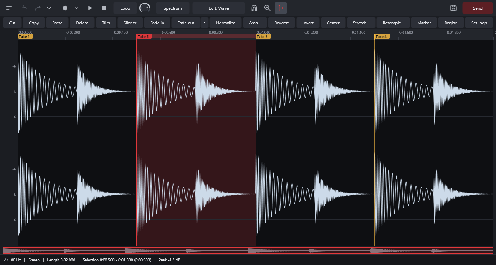

---

## Phase 2.3 — Colorful, Readable Theme

### What Changed
1. **High-Contrast Midnight-Slate Default Palette (`src/core/ThemePalette.h`, `src/core/ThemePalette.cpp`, `src/ui/Theme.h`, `src/ui/Theme.cpp`)**:
   - Upgraded the default `"LYNX"` theme to a deep midnight-slate surface hierarchy (`bg0 = #0A0D14`, `bg1 = #111520`, `bg2 = #171C28`, `bg3 = #1F2636`, `bg4 = #283044`, `bg5 = #333D54`, `bg6 = #404C68`) with vivid crimson primary accent (`#E02844`).
   - All text tiers meet or exceed **WCAG AA / AAA**:
     - `textPrimary` (`#F4F6FB`) on `bg2`: **15.7:1** (WCAG AAA)
     - `textSecondary` (`#C6CDDB`) on `bg2`: **9.3:1** (WCAG AAA)
     - `textDisabled` (`#8A94A8`) on `bg2`: **4.8:1** (WCAG AA, up from 2.7:1 previously)
     - `onAccent` (`#FFFFFF`) on `accent` (`#E02844`): **4.6:1** (WCAG AA, up from 4.2:1 previously)
   - Preserved the previous default look as **`"LYNX Classic"`** (`#E5383B` / `#15161A`) right under `"LYNX (default)"` in **Options > Theme**.
2. **Vivid Per-Window Accent Identity & Focus States (`src/ui/Workspace.cpp`, `src/ui/MainComponent.cpp`)**:
   - Assigned each main workspace window its own vivid accent colour:
     - **Playlist**: Electric Cyan (`#00C8FF`)
     - **Channel Rack**: Vivid Coral Orange (`#FF6B35`)
     - **Piano Roll**: Vivid Emerald Mint (`#10D98C`)
     - **Mixer**: Vivid Violet Amethyst (`#A855F7`)
     - **Browser**: Vivid Amber Gold (`#F59E0B`)
   - Styled `PanelFrame` title bars, vertical title-bar accent pill badges, full-width top accent bars (`3px` + glow when focused, `2px` when unfocused), crisp window-accent panel borders, and the 5 window toggle buttons in the top toolbar with their respective window accents.

### Verification
- `LYNX_TEST=theme162 ./build-local/lynx_tests` -> **39 checks, 0 failures**.
- `LYNX_TEST=rack170a ./build-local/lynx_tests` -> **70 checks, 0 failures**.
- `LYNX_TEST=translations ./build-local/lynx_tests` -> **106 checks, 0 failures**.
- `LYNX.exe --selftest` -> **`result=OK`**.
- `LYNX.exe --export` + `./build-local/comparewav`: **0.0 dB difference across all octave bands, 1.00 envelope correlation**.

---

## Before vs. After Screenshots (`--snapshot`)

### 1. All Workspace Windows (`snap-desktop-all.png`)

**After:**
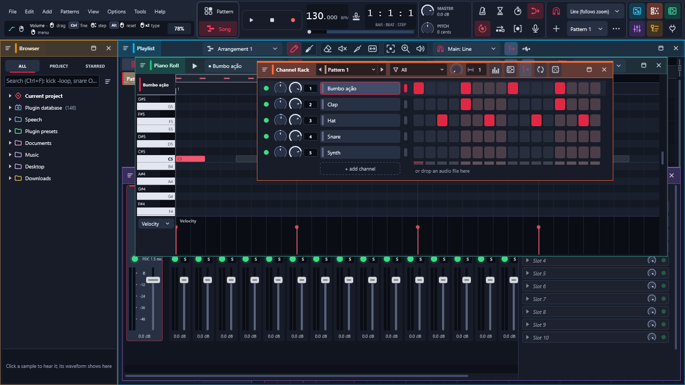

**Before:**
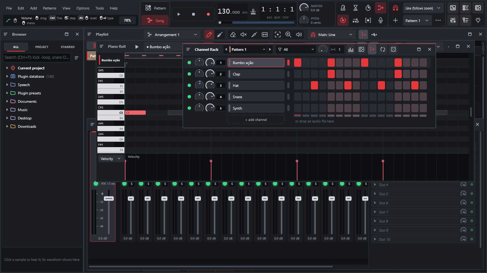

---

### 2. Playlist (`snap-playlist.png` — Electric Cyan `#00C8FF`)

**After:**
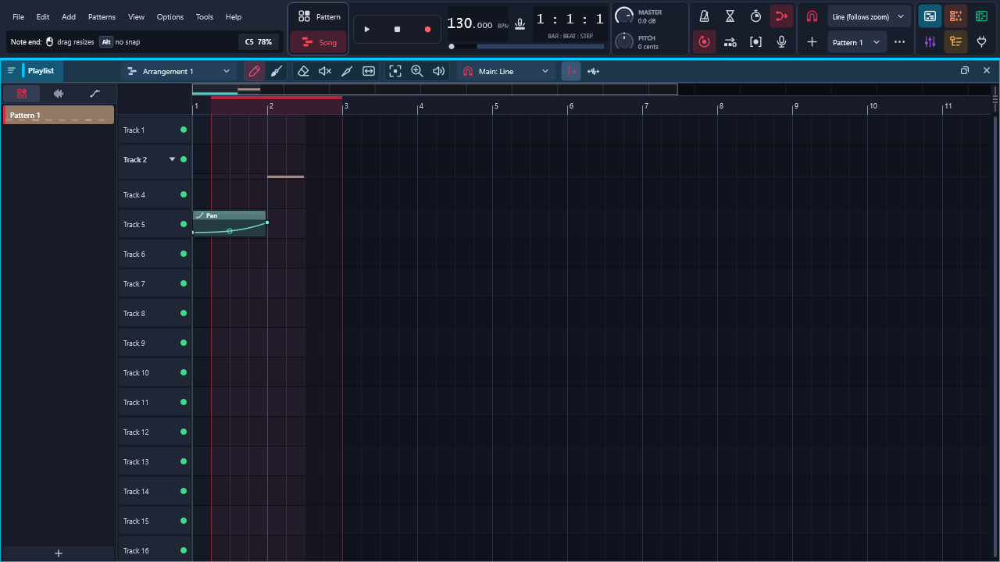

**Before:**
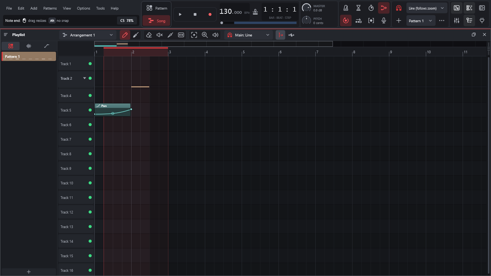

---

### 3. Channel Rack (`snap-rack.png` — Vivid Coral Orange `#FF6B35`)

**After:**
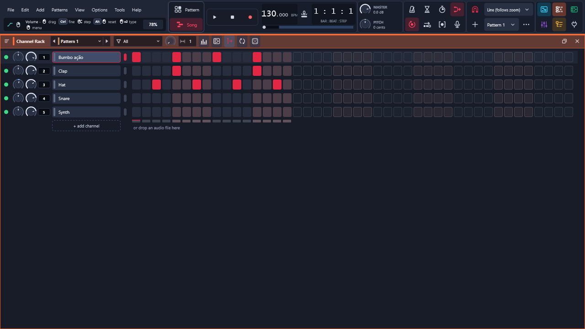

**Before:**
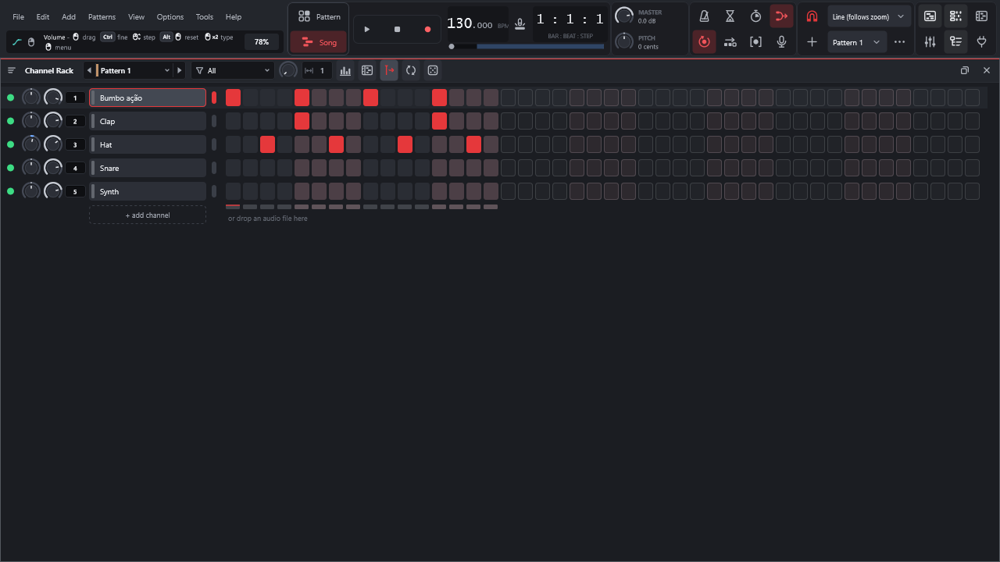

---

### 4. Piano Roll (`snap-pianoroll.png` — Vivid Emerald Mint `#10D98C`)

**After:**
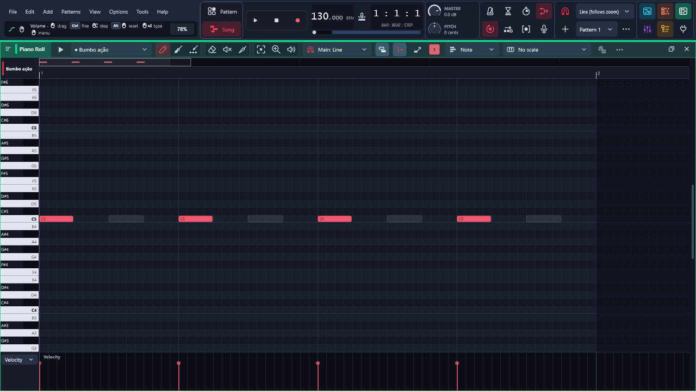

**Before:**
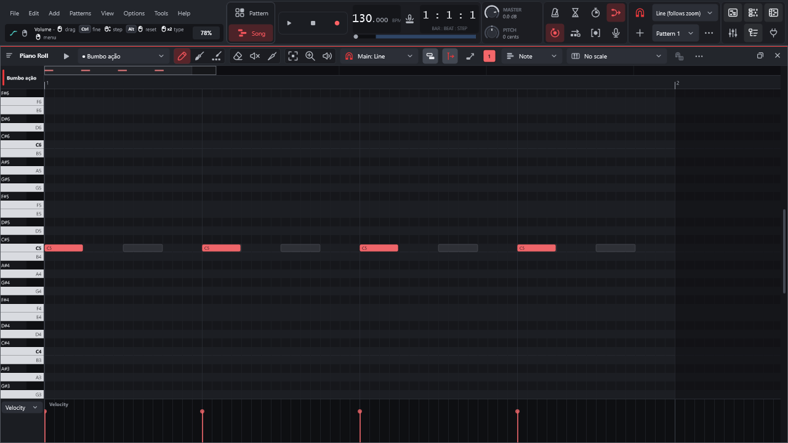

---

### 5. Mixer (`snap-mixer.png` — Vivid Violet Amethyst `#A855F7`)

**After:**
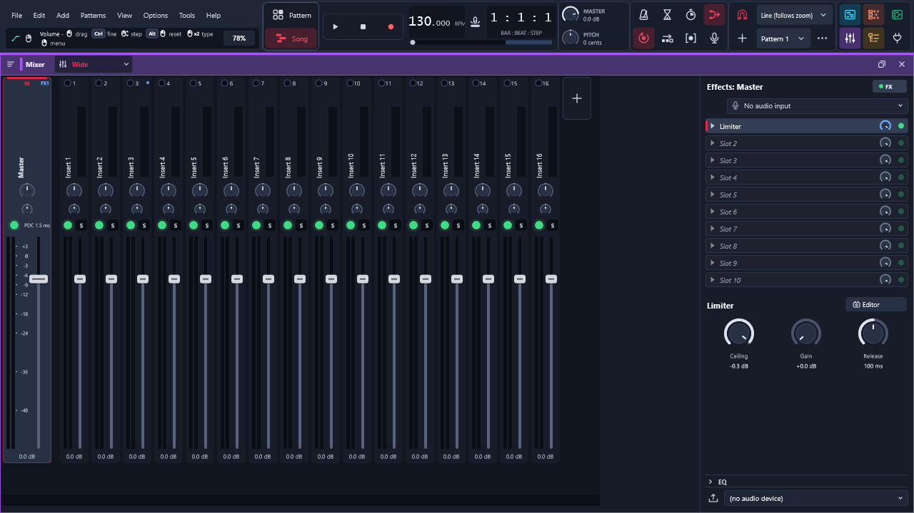

**Before:**
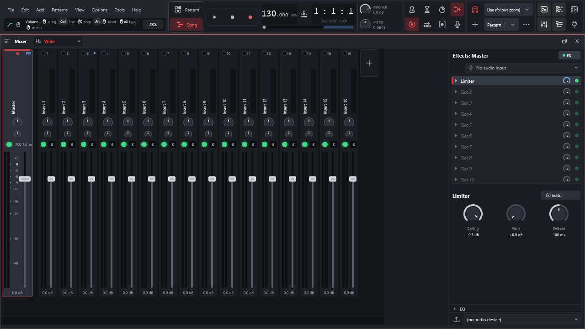

---

### 6. Browser (`snap-browser-tree.png` — Vivid Amber Gold `#F59E0B`)

**After:**
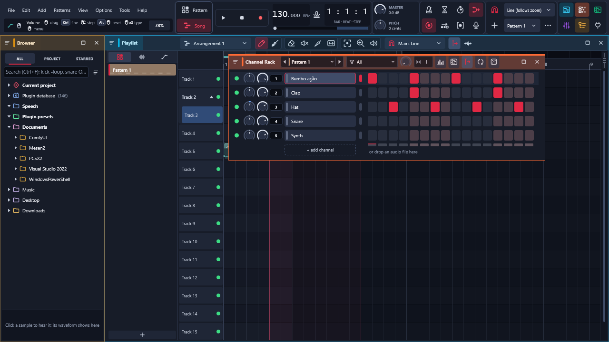

**Before:**
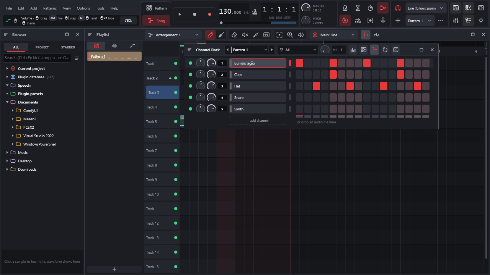

---

### 7. Theme Settings (`snap-settings-theme.png`)

**After:**
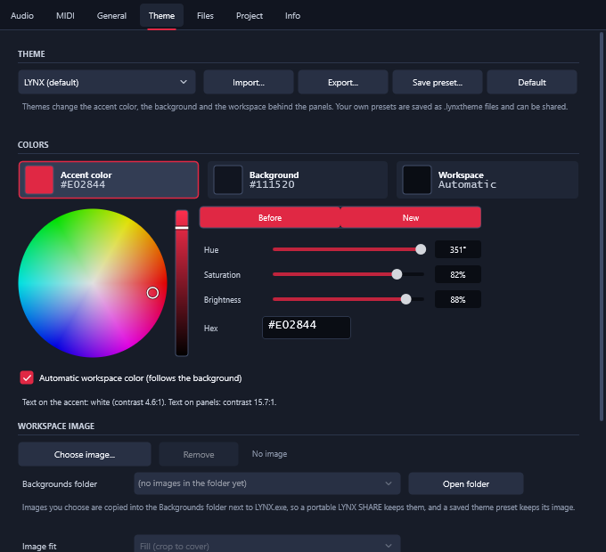

**Before:**
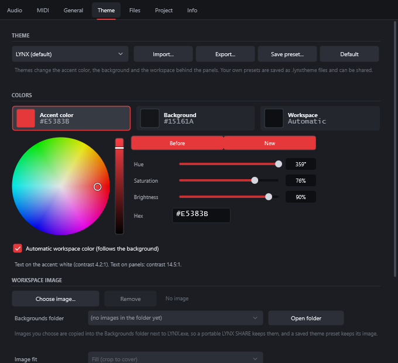
